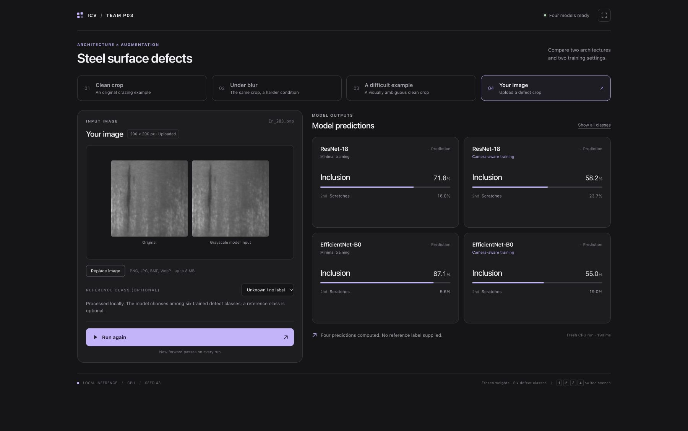

# P03: Industrial Surface Defect Classification

We classify cropped hot-rolled steel defects into six NEU-CLS classes and compare ResNet-18 with EfficientNet-B0 under minimal and camera-aware training augmentation. The study asks whether the smaller architecture preserves quality and whether augmentation improves robustness to acquisition-related changes.

The registered experiment is complete: four configurations, seeds 42/43/44, clean test and 27 corruption conditions per checkpoint. Results and code are available here; model weights remain in the downloadable [Kaggle run output](https://www.kaggle.com/code/datastr3am/icv-final-project-results?scriptVersionId=364524496).

## Main results

| Configuration | Clean macro-F1 | Mean corrupted macro-F1 | Parameters | T4 latency, ms |
|---|---:|---:|---:|---:|
| ResNet-18 minimal | 1.0000 ± 0.0000 | 0.8293 ± 0.0077 | 11.18M | 3.65 ± 0.11 |
| ResNet-18 camera | 0.9963 ± 0.0032 | 0.9577 ± 0.0152 | 11.18M | 3.60 ± 0.18 |
| EfficientNet-B0 minimal | 0.9963 ± 0.0016 | 0.7387 ± 0.0346 | 4.02M | 8.85 ± 0.05 |
| EfficientNet-B0 camera | 0.9954 ± 0.0058 | 0.9501 ± 0.0139 | 4.02M | 8.85 ± 0.10 |

F1 values are mean ± sample SD across three seeds. Corrupted F1 first averages the 27 condition-level macro-F1 scores within a seed. Latency is mean ± sample SD of three run-level medians: FP32, batch one, Tesla T4, ten warm-up and 50 synchronized timed forwards, excluding loading, preprocessing and host-to-device transfer.

Camera-aware augmentation increases mean corrupted F1 by 0.1285 for ResNet and 0.2114 for EfficientNet. Clean accuracy and calibration do not improve automatically. The camera-model ranking changes across seeds. EfficientNet uses about 64% fewer parameters but has higher measured batch-one latency in this implementation. The [full analysis](reports/final/results_checkpoint_20261103.md) includes clean accuracy, NLL, ECE, runtime and three real failure examples.

## Dataset and task

NEU-CLS provides 1,800 grayscale 200 × 200 defect crops. One exact duplicate is excluded, leaving 1,799 active images: 1,259 train, 180 validation and 360 test, with 60 test images per class. The fixed [manifest](data/manifests/neu_cls_v2.csv) and [reviewed groups](data/README.md) keep known duplicates within a split.

Classes: crazing, inclusion, patches, pitted surface, rolled-in scale and scratches. There is no normal/defect-free class. The model classifies an already cropped defect; it does not locate defects or estimate production false alarms on normal steel.

Inputs are grayscale repeated over three channels, resized to 224 × 224 with bilinear antialiasing and ImageNet normalization. Both architectures use ImageNet-1K V1 initialization and a six-class head; all layers are fine-tuned. Training uses batch 32, two loader workers, AdamW with learning rate and weight decay 1e-4, label smoothing 0.05, three warm-up epochs, cosine decay, a 50-epoch cap, patience 10 and CUDA mixed precision. The earliest strict maximum of clean validation macro-F1 selects a checkpoint. The final runner overrides the four YAML files' base worker count to two; saved resolved configurations record the actual values.

## Install and verify

Use Python 3.11 and uv for the locked local setup:

```bash
uv sync --locked --python 3.11 --extra dev --extra data --extra notebook
uv run --no-sync ruff check .
uv run --no-sync pytest
uv run --no-sync python scripts/verify_saved_results.py
```

The saved-result check independently recalculates all 336 condition results from 120,960 prediction rows and checks the summary aggregation. It requires neither a GPU nor images nor weights. These rows are paired transformations of 360 test crops, not independent new samples.

The original Kaggle experiment used Python 3.13.15, PyTorch 2.11.0+cu128, torchvision 0.26.0+cu128 and CUDA 12.8. [Environment records](environment/README.md) distinguish that training session from the locked local inference environment. The package accepts Python 3.11 through 3.13.

## Final submission

[Technical summary, 2 pages](technical_summary.pdf) | [Presentation slides, 3 pages](slides/final_presentation.pdf) | [English speaker notes and team roles](slides/speaker_notes.md)

The notes allocate the explanation to all four team members and fit within the five-minute presentation slot. The two-minute demo follows separately.

## Live demo

Open [09_live_demo.ipynb](notebooks/09_live_demo.ipynb) using the [demo setup guide](notebooks/README_LIVE_DEMO.md). Two verified example crops are included, so the presentation does not require downloading the complete dataset. Download the Kaggle results ZIP into `results_download/`, then run:

```bash
uv run --no-sync python -B notebooks/check_live_demo.py --weights results_download/icv_final_results.zip
uv run --no-sync jupyter lab notebooks/09_live_demo.ipynb
```

Run the preparation cell before the talk, then the three scene cells individually: clean crazing, the same crop with Gaussian blur, and a real clean-test error. All four models compute fresh top-1/top-2 probabilities on CPU. [Recorded notebook verification](environment/live_demo_verified.json) checks all 12 case/model comparisons with network access blocked. Record the scenes for the submission video and verify them on the presentation device before the defense.

### Local web interface

A local web application demonstrates the same four trained seed-43 models: ResNet-18 and EfficientNet-B0, each with minimal or camera-aware training. Users can select prepared examples or upload a steel-defect image, then compare predicted classes and class probabilities side by side. All models run locally on CPU with the shared preprocessing pipeline. Uploaded images have no reference label by default; an optional user-supplied label is used only to assess the predictions after inference.



*Local demo with an uploaded image. The displayed CPU time covers the current four-model demo run and is separate from the T4 latency benchmark above.*

The browser interface is currently a local presentation tool. To reproduce inference using the published code, use the notebook above or the command-line classifier below.

## Run the working classifier

Follow [the dataset and weight preparation instructions](docs/REPRODUCIBILITY.md) once. Download `icv_final_results.zip` from the linked Kaggle version into `results_download/`, then restore the verified demo weights:

```bash
uv run --no-sync python scripts/prepare_final_artifacts.py --archive results_download/icv_final_results.zip
uv run --no-sync python scripts/infer_image.py --image data/raw/NEU-CLS/NEU-CLS/Cr_107.bmp --device cpu
uv run --no-sync python scripts/infer_image.py --image data/raw/NEU-CLS/NEU-CLS/Cr_107.bmp --corruption gaussian_blur --severity 3 --device cpu
```

Inference performs real model forwards with all four seed-43 checkpoints and prints the six class probabilities plus top-1/top-2. It loads weights without downloading pretrained initialization. Once weights and inputs are present, it works offline and requires no training. [Demo cases](demo/cases.json) and [reference outputs](demo/reference_outputs.csv) support implementation checks; reference outputs are not used by the classifier. The [local CPU smoke-test](environment/local_inference_verified.json) matched all 12 top-1 outputs across the three scenarios, with maximum probability difference from Kaggle below 0.000006. The presentation notebook also has its own offline cell check; the presentation device still needs its final rehearsal.

## Reproduce the full experiment

Import [the final Kaggle notebook](notebooks/08_kaggle_results_checkpoint.ipynb), enable GPU T4 and Internet, and follow [the reproduction guide](docs/REPRODUCIBILITY.md). The unchanged recorded workflow reuses four verified historical seed-43 checkpoints and trains eight missing runs. Setting `RETRAIN_SEED43=True` before a fresh run trains all 12 instead. Local training is not required.

The final runner freezes the protocol and checkpoint hashes before test evaluation. All four conditions share data loaders, training code, checkpoint selection and evaluation. Only architecture and the training augmentation package differ. [The readable final helpers](src/industrial_surface_defects/results_checkpoint.py) match the notebook's recorded payload; the notebook intentionally retains the source revision used by the experiment.

## Code and evidence

| Location | Contents |
|---|---|
| `src/industrial_surface_defects/` | Shared data, transforms, training, evaluation, final-stage orchestration and verified image inference. |
| `configs/`, `data/manifests/` | Registered configurations, reviewed split and source hashes. |
| `notebooks/08_kaggle_results_checkpoint.ipynb` | Executed final training/evaluation runner, preserved unmodified. |
| [notebooks/09_live_demo.ipynb](notebooks/09_live_demo.ipynb) | Working CPU demo with images, four-model predictions and offline verification. |
| `scripts/` | Dataset download, matrix tools, artifact preparation, single-image inference and independent result verification. |
| [results/final](results/final/README.md) | Per-run and per-condition predictions/metrics, histories, runtime, protocol, hashes and figures. |
| [reports/final](reports/final/results_checkpoint_20261103.md) | Checked experimental report and representative failure analysis. |
| [environment](environment/README.md) | Recorded Kaggle environment and local setup details. |
| [tests](tests/) | Pipeline tests, final-stage checks and inference/artifact validation. |

Historical baseline reports remain under `reports/`; their validation-only statements describe the earlier milestone. The full raw dataset, downloaded archives and checkpoints are excluded from Git. Only two hash-verified demonstration crops are included under `notebooks/demo_assets/`. The complete Kaggle archive contains weights and additional logs/input fingerprints.

The team's existing [independent audit tools](scripts/audit/README.md) are retained. `scripts/verify_final_results.py` audits the complete extracted Kaggle bundle, including bootstrap and raw-data evidence. `scripts/verify_saved_results.py` checks the smaller evidence set committed here without requiring raw images or weights.

## Conclusions and limitations

The main measured benefit is robustness from the augmentation package, with a small clean-quality trade-off. Synthetic corruption families overlap the training augmentation, and these results do not establish robustness to an unseen factory or camera. Three training seeds and 360 same-dataset test crops limit the conclusions. All five registered clean-contrast bootstrap intervals contain or touch zero; this does not prove model equivalence. No test-informed change was made to the split, checkpoint rule, labels or severities.

## Team

- Danil Khasanshin, team leader: d.khasanshin@innopolis.university. Shared pipeline, experiment coordination, result/report integration, repository assembly and reproduction instructions.
- Timur Kagarmanov: t.kagarmanov@innopolis.university. Independent data, metric and bootstrap audit, audit scripts and representative failure cases.
- Ruslan Nasibullin: ru.nasibullin@innopolis.university. Six ResNet-run reviews, runtime verification for all 12 checkpoints, and the offline inference demo.
- Nikita Selezenev: n.selezenev@innopolis.university. Six EfficientNet-run reviews, robustness/calibration comparison, plots and the final presentation slides.

[Detailed contributions](docs/CONTRIBUTIONS.md). [Team Git repository](https://github.com/kujifined/Introduction-to-cv).
