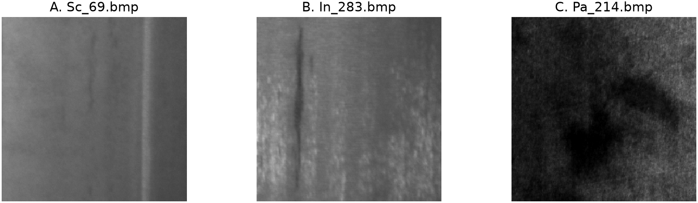

# Industrial Surface Defect Classification: Results Checkpoint

**Team P03 • 3 November 2026**

[Team repository](https://github.com/kujifined/Introduction-to-cv) | [Executed Kaggle notebook and downloadable results](https://www.kaggle.com/code/datastr3am/icv-final-project-results?scriptVersionId=364524496)

## Final results

We compared ResNet-18 and EfficientNet-B0 with minimal preprocessing or camera-aware training augmentation. The question was whether the smaller EfficientNet preserves classification quality, and whether augmentation improves robustness to acquisition shifts. All 12 planned runs are complete: four configurations at seeds 42, 43 and 44. Four existing seed-43 checkpoints were reused unchanged; eight additional models were trained for this milestone.

NEU-CLS contains six defect classes: crazing, inclusion, patches, pitted surface, rolled-in scale and scratches. Removing one exact duplicate leaves 1,799 images, split into 1,259 training, 180 validation and 360 test images, with 60 test images per class. Active paths, hashes and reviewed groups do not cross splits. Inputs are three-channel grayscale, resized to 224 × 224 and ImageNet-normalized. Both architectures use ImageNet-1K V1 initialization and full fine-tuning with AdamW, learning rate and weight decay 1e-4, batch 32, label smoothing 0.05, three warm-up epochs, cosine decay, a 50-epoch cap and patience 10. The earliest strict maximum of clean validation macro-F1 selects the checkpoint.

Clean test results are below. Macro-F1 is mean ± sample SD across three seeds; accuracy, negative log-likelihood (NLL) and ten-bin calibration error (ECE) are seed means. Balanced accuracy equals accuracy because class support is equal. Lower NLL and ECE are better.

| Configuration | Accuracy | Macro-F1 | NLL | ECE |
|---|---:|---:|---:|---:|
| ResNet-18 minimal | 1.0000 | 1.0000 ± 0.0000 | 0.0448 | 0.0426 |
| ResNet-18 camera | 0.9963 | 0.9963 ± 0.0032 | 0.0553 | 0.0460 |
| EfficientNet-B0 minimal | 0.9963 | 0.9963 ± 0.0016 | 0.0981 | 0.0812 |
| EfficientNet-B0 camera | 0.9954 | 0.9954 ± 0.0058 | 0.1178 | 0.0949 |

## Comparison

The controlled 2 × 2 comparison changes architecture and training augmentation while retaining the shared pipeline and training settings. Camera-aware augmentation adds small affine changes and exposure, contrast, gamma, noise, blur or JPEG effects. After freezing checkpoints and evaluation choices, each model was evaluated on clean test and nine corruption types at three severities: darkening, brightening, contrast, gamma, shot/read noise, Gaussian blur, horizontal and vertical motion blur, and JPEG compression. This produces 336 model/seed/condition evaluations. Robustness is the unweighted mean of 27 condition-level macro-F1 scores within each seed, followed by mean ± sample SD across seeds. Drop is clean F1 minus mean corrupted F1 within each run, then averaged across seeds.

| Configuration | Mean corrupted macro-F1 | Mean F1 drop |
|---|---:|---:|
| ResNet-18 minimal | 0.8293 ± 0.0077 | 0.1707 |
| ResNet-18 camera | 0.9577 ± 0.0152 | 0.0386 |
| EfficientNet-B0 minimal | 0.7387 ± 0.0346 | 0.2576 |
| EfficientNet-B0 camera | 0.9501 ± 0.0139 | 0.0453 |

Augmentation improves mean corrupted F1 for both architectures at every seed, with average gains of 0.1285 for ResNet and 0.2114 for EfficientNet. It does not improve every condition or clean probability quality: EfficientNet clean NLL and ECE increase. ResNet camera has the highest corrupted mean, but EfficientNet camera leads at seed 44, so the architecture ranking is not consistent. Severe blur remains a weakness: camera EfficientNet reaches only 0.6204 under Gaussian blur at seed 43, and camera ResNet reaches 0.6823 under horizontal motion blur at seed 44. All five registered clean-contrast 95% intervals from 5,000 paired, class-stratified image resamples contain or touch zero; this does not prove equivalence. Training-seed SD is separate from image-bootstrap uncertainty.

## Runtime

All checkpoints were benchmarked in one session on a Tesla T4 using FP32, batch one, ten warm-up and 50 synchronized timed forward passes. Loading, preprocessing and CPU-to-GPU transfer are excluded. Latency below is the mean ± sample SD of three run-level medians. Training-stage ranges include validation and output generation; seed-43 training is historical, so these are not isolated augmentation-overhead benchmarks.

| Configuration | Parameters | Training stage, s | Latency, ms |
|---|---:|---:|---:|
| ResNet-18 minimal | 11.18M | 40.62 to 43.67 | 3.65 ± 0.11 |
| ResNet-18 camera | 11.18M | 54.21 to 64.95 | 3.60 ± 0.18 |
| EfficientNet-B0 minimal | 4.02M | 68.25 to 86.68 | 8.85 ± 0.05 |
| EfficientNet-B0 camera | 4.02M | 68.59 to 96.79 | 8.85 ± 0.10 |

EfficientNet has about 64% fewer parameters but is slower in this batch-one implementation. Checkpoints occupy approximately 15.60 MiB versus 42.72 MiB for ResNet. Runs completed 12 to 14 epochs and selected epochs 2 to 4. The evaluation environment was Python 3.13.15, PyTorch 2.11.0+cu128, torchvision 0.26.0+cu128 and CUDA 12.8; training used mixed precision. Configurations, histories, per-seed metrics, runtime records and weights are saved in the Kaggle output. Independent team checks reproduced the reported metrics and bootstrap results.

## Failure analysis

There are 13 clean-test error rows across six distinct images and 12 checkpoints. The three examples below are different original, uncorrupted test images. Confidence is the predicted-class probability. Explanations are visual hypotheses, not established model mechanisms or changes to the dataset labels.

**A. Sc_69.bmp, scratches.** EfficientNet minimal, seed 44, predicts inclusion with confidence 0.7100; six of 12 checkpoints make this confusion. The soft, low-contrast elongated mark may resemble an inclusion. All three minimal ResNets classify it correctly.

**B. In_283.bmp, inclusion.** ResNet camera, seed 44, predicts scratches with confidence 0.6134. The narrow vertical geometry resembles a scratch. Only camera ResNet seeds 42 and 44 fail, showing that augmentation does not remove this seed-sensitive ambiguity.

**C. Pa_214.bmp, patches.** EfficientNet camera, seed 42, predicts pitted surface with confidence 0.3779, narrowly above patches at 0.3753. The diffuse boundary and mottled interior may resemble clustered pits. The other 11 checkpoints are correct.

These results concern 360 shared test crops and paired transformed views, not independent new images or real production-camera shifts. Corruption families overlap the training augmentation package, and three seeds limit generalization. NEU-CLS has no normal class, so defect-class false positives do not estimate an industrial false-alarm rate. No split, checkpoint rule or severity was changed after test inspection.

**Completed contributions:**
- **Danil Khasanshin** (d.khasanshin@innopolis.university): shared experiment, result integration and report
- **Timur Kagarmanov** (t.kagarmanov@innopolis.university): independent data, metric and bootstrap audit, and three failure cases
- **Ruslan Nasibullin** (ru.nasibullin@innopolis.university): six ResNet runs and runtime verification for all 12 checkpoints
- **Nikita Selezenev** (n.selezenev@innopolis.university): six EfficientNet runs, four-configuration robustness/calibration comparison and plots
